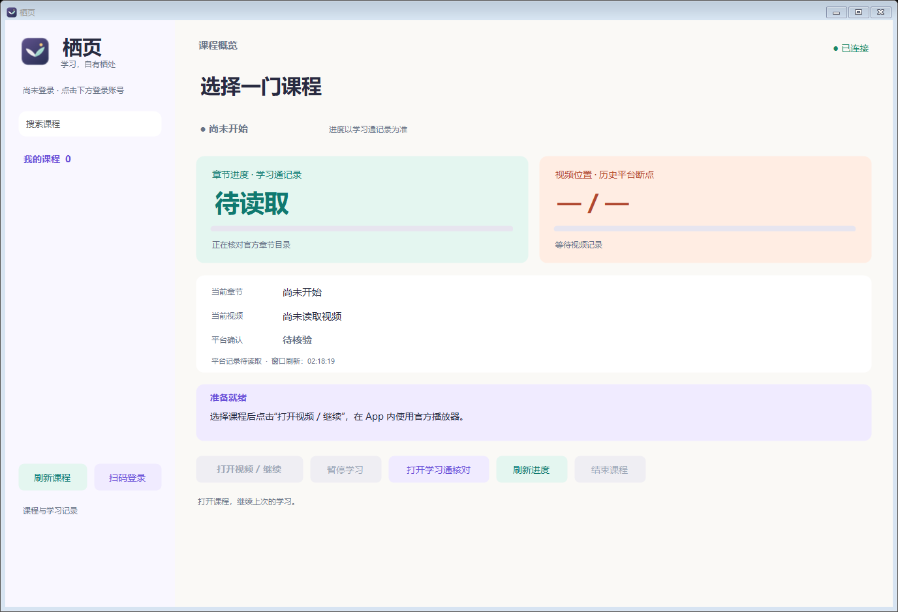

<div align="center">
  
  <h1>栖页 Qiye</h1>
  <p>学习，自有栖处。</p>
  <p>Windows 桌面学习助手 · 官方网页内嵌 · 扫码登录 · 播放控制 · 课程作业</p>
</div>

栖页将学习通官方页面放进桌面窗口，提供扫码登录、课程目录、播放进度、暂停/继续、静音、章节任务衔接和作业查题填写。项目基于 [SuperAutoStudy](https://github.com/DuanInnovator/SuperAutoStudy) 开发，沿用 Apache 2.0 许可。

这是第三方开源项目，与学习通官方无隶属关系。学习记录及课程完成情况以平台记录为准，请按所在学校和课程的要求使用。

> [!WARNING]
> **一定不要自行添加、修改或开启倍速功能，始终保持 1 倍速。开启倍速会导致学习通显示“数据异常”。**
> 不要通过修改代码、配置、浏览器脚本或外部插件强制加速。配置中的 `study.chaoxing.speed` 必须保持为 `1`。



## 配置要求

| 项目 | 要求 |
| --- | --- |
| 操作系统 | Windows 10 / 11，64 位 x64；目前不提供 macOS、Linux 或 ARM 原生版 |
| 内存与空间 | 建议至少 4 GB 内存；为应用、运行组件、数据库及缓存预留至少 3 GB 可用空间 |
| .NET Framework | 4.7.2 或更高版本；系统缺少时需先安装 |
| Microsoft 组件 | Edge WebView2 Runtime、Visual C++ x64 Runtime；缺少时安装流程会尝试从 Microsoft 官方来源准备 |
| PowerShell | Windows PowerShell 5.1；用于首次准备组件及管理本机服务 |
| 安装路径 | 可写的独立英文目录，例如 `E:\Qiye`；可以含空格，不支持中文路径，也不要选择磁盘根目录 |
| 网络 | 登录及学习需要联网；首次安装还需能访问 GitHub / Adoptium、MySQL 和 Microsoft 官方下载地址 |
| 账号 | 使用者自己的学习通账号，通过官方扫码登录；验证码、人脸及身份确认需要本人完成 |

普通用户**不用手动安装 Java、MySQL、Maven 或 Visual Studio**。首次启动自动下载固定版本的 Java 8 和 MySQL 8.0.44，校验散列后创建全新本地数据库。首次下载约 **335 MB**，后续启动会复用已准备好的组件。

## 下载与安装

维护者发布版本后，在仓库右侧 **Releases → 最新版本** 下载以下文件。GitHub 页面上的 **Code → Download ZIP 是源码**，不能直接当作 App 使用。

| 文件 | 用途 |
| --- | --- |
| `Qiye-Setup-1.1.5-win-x64.exe` | **推荐普通用户使用**：图形安装程序，可选择目录并创建桌面快捷方式 |
| `Qiye-1.1.5-win-x64.zip` | 便携版：完整解压到独立英文目录，再运行 `Qiye.exe` |
| `Qiye-1.1.5-source.zip` | 源码包：供开发者阅读、修改和构建 |
| `SHA256SUMS.txt` | 发布文件的 SHA-256 校验值 |

1. 双击安装程序，选择独立目录，例如 `E:\Qiye`。
2. 点击“安装并启动”，等待组件下载、校验、解压和本机服务启动。
3. 系统缺少 Microsoft 运行组件时，按官方安装程序的提示完成安装。
4. 打开“栖页”后，按下面的步骤扫码登录。以后使用桌面快捷方式或安装目录的 `Qiye.exe` 启动。

安装程序和便携版首次运行都需要联网准备组件，均不是完全离线包。安装程序目前未进行代码签名，Windows 可能显示未知发行者；可使用发布页的校验值核对文件。请保留完整安装目录，不要只复制 `desktop/StudyDesktop.exe`。

## 使用说明

### 扫码登录与课程播放

1. 点击左下角“扫码登录”，用手机学习通的“扫一扫”扫描二维码，并在手机上确认。
2. 等待课程列表同步，选择课程，点击“打开视频 / 继续”。
3. App 在窗口内打开官方课程页，识别当前知识点的视频及检测等任务；一个知识点可能包含多个视频。
4. 首次播放如果被浏览器拦截，在官方视频区域手动点击播放。全程保持 **1 倍速**。
5. 视频播放位置、平台断点和章节完成记录分别显示；点击“刷新进度”可重新核对官方记录。

| 控制项 | 作用 |
| --- | --- |
| 暂停学习 | 暂停视频和自动操作，直到主动继续 |
| 播放 / 继续 | 恢复本次学习；页面打开失败时也可重试 |
| 结束课程 | 结束当前学习、收起课程页面，保留记录 |
| 刷新进度 / F5 | 重新读取官方目录与进度，不补写观看时长 |
| 设置 → 静音 | 对后续新视频持续生效 |
| 收起/展开章节 | 调整官方目录区域，腾出视频空间 |

验证码、人脸或身份确认需要本人处理。视频到达末尾后，平台可能尚未确认整个知识点完成；请同时检查其他视频和必需任务。

### 课程作业：查询填写，手动提交

1. 选中课程，点击“课程作业”，再点击“读取作业”。原课程视频会暂停。
2. 双击左侧未完成作业，或在右侧官方页面自行进入作业。
3. 进入题目后，手动点击“刷作业”。App 显示查题、已填写、保留原答案和留空的数量。
4. 仅填写可以可靠匹配的空白题；已有答案和部分填写的内容保留，未命中或无法确认的题目留空。
5. 自行检查、补全答案，并在官方页面**手动提交**。App 不会点击作业提交或确认按钮。
6. 做下一份时直接双击左侧对应作业，进入后再点“刷作业”；点击“读取作业”更新未完成列表。

支持单选、多选、判断，以及可识别输入框的填空/简答题，实际可用范围取决于题库及页面结构。“停止查题”、切换作业或离开页面会取消后续填写；迟到的旧答案不会写到新作业。

**作业与章节检测的设置不同。** 章节检测/视频弹题开启“题库自动答题并提交”后，当前实现对部分未匹配题可能使用随机候选答案并提交；需要逐题检查时请关闭该开关。课程作业始终遵循未匹配留空、手动提交的规则。

## 题库与本机配置

首次安装自动生成 `config/application-local.yml`；公开仓库仅提供 `config/application-local.example.yml` 模板。普通用户可以直接使用默认配置，不需要填写数据库密码或部署远程服务。

当前查询顺序为：**可选本地 JSON 题库 → cxmooc 在线题库 → 不挂科补查**。本地库默认关闭；不挂科补查支持单选、多选和判断。找到可匹配答案后停止继续查询；第三方服务可能限流、失效或返回不准确的答案。

| 配置项 | 默认值 / 说明 |
| --- | --- |
| `study.chaoxing.speed` | **`1`，必须保持，不要修改或自行开发倍速功能** |
| `tiku.settings.provider` | `cxmooc`，在线主查询来源 |
| `tiku.settings.local-bank-file` | 空字符串；填写自备 JSON 文件的绝对路径后启用本地库 |
| `tiku.settings.buguake-enabled` | `true`，主查询未返回可匹配答案时补查 |
| 端口、数据库及安装标识 | 首次安装自动生成；一般无需手动修改 |

本地选择题要求题干、题型和完整选项集合相同，按选项文字重新映射；同题同选项出现不同答案时留空。**把多个文件放进文件夹不会自动读取全部题库**，需要先整理成一个符合格式的 JSON 文件，再指定该文件路径。

公开版不附带个人账号、登录状态、课程记录或个人合并题库；其他使用者可自备题库文件。更改配置前退出 App 并运行 `Stop-Services.cmd`，修改后重新启动。具体字段见 [配置说明](docs/CONFIGURATION.md)，本地文件格式见 [本地题库说明](docs/LOCAL-QUESTION-BANK.md)。

## 注意事项

1. **一定不可以自行添加或开启倍速功能。保持 1 倍速，否则学习通会显示“数据异常”。** 不要修改 `study.chaoxing.speed`、视频播放速率或用外部脚本强制加速。出现异常时恢复 1 倍速、刷新官方页面并核对平台记录。
2. 播放位置不等于平台确认的观看记录，章节完成也不等于单个视频播完；完成情况以学习通官方记录为准。
3. 题库匹配不代表答案必然正确。作业填写后请自行检查，空白题自行补全，最后手动提交。
4. 验证码、人脸、身份确认及课程要求的本人操作，需要使用者自行处理。
5. 安装目录包含本地数据库和登录信息。分享软件请使用 Release 发布包，不要打包自己使用过的整个目录。
6. 移动、备份或卸载前，先关闭 App 并运行 `Stop-Services.cmd`。保留记录时同时备份 `data/` 与 `config/`，不要上传它们到公开仓库。

详细说明见 [注意事项](docs/NOTES.md)。

## 常见问题

**首次安装很慢？** 先看安装窗口的当前阶段。首次需下载约 335 MB 组件，速度取决于网络；中断后在原目录重试，已校验成功的组件可复用。

**看过视频，进度还是 0？** App 约每 30 秒核对官方记录，也可点击“刷新进度”。确认使用 1 倍速，并检查当前知识点是否还有未完成的视频、检测或其他任务。

**未读取到作业？** 先检查右侧是否已进入官方作业菜单、登录是否失效及当前课程是否有可作答作业，再重新点击“读取作业”。列表是最近一次读取结果，提交后可手动刷新。

**作业填写 0 题？** 查看留空原因：题库未命中、答案无法确认、页面/题型未支持或查询/填写失败。单题未命中不代表整门课都没有题库。

**关闭窗口后后台还在？** 关闭 App 会结束网页播放；再运行安装目录的 `Stop-Services.cmd` 关闭本机服务，下次启动会自动恢复。

更多排查步骤见 [完整使用说明](docs/USAGE.md)。

## 从源码构建

开发环境需要 Windows x64、JDK 8、Maven 3.9+、.NET Framework 4.7.2+ 及其 C# 编译器。WebView2 SDK 的可再发行 DLL 和许可已保留在源码中，无需安装 Visual Studio；构建依赖通过 Maven Central 下载。

在源码根目录使用 PowerShell：

```powershell
.\scripts\Build-Release.ps1 -Version 1.1.5
```

Java 或 Maven 未加入环境变量时，可指定路径：

```powershell
.\scripts\Build-Release.ps1 -Version 1.1.5 `
  -JavaHome 'C:\Dev\jdk8' -Maven 'C:\Dev\maven\bin\mvn.cmd'
```

脚本执行后台测试，编译桌面 App 和安装器，检查公开归档内容，并在 `dist/` 生成安装程序、便携版、源码包及校验文件。详见 [开发说明](docs/DEVELOPMENT.md)。

## 文件结构与上传 GitHub

```text
desktop/       Windows 客户端源码、图标、WebView2 SDK DLL 与合成测试
backend/       Java 本机服务、Maven 配置、空白数据库结构及测试
installer/     安装程序与启动器源码
scripts/       环境准备、服务管理、构建与归档检查
config/        公开配置模板
docs/          配置、使用、注意事项、开发与发布文档
third-party/   第三方声明
.github/       GitHub Actions 构建与发布工作流
```

将上述源码内容放到自己仓库的根目录，保留 `README.md`、`LICENSE`、`NOTICE`、第三方许可和隐藏的 `.github/`、`.gitignore` 等文件。**安装程序和便携包上传到 Releases**；不要把源码 ZIP 当成唯一的仓库内容，也不要把运行目录直接上传。

`data/`、真实配置、`research/`、日志、缓存、浏览器数据、运行组件和构建产物均属于本机文件。首次上传、Release 附件和 Actions 的操作步骤见 [GitHub 发布说明](docs/PUBLISH.md)。

## 开源与来源

代码使用 [Apache License 2.0](LICENSE)，上游来源和修改说明见 [NOTICE](NOTICE)。WebView2、Java、MySQL 及 Java 依赖遵循各自许可证，详见 [第三方声明](THIRD_PARTY.md)。[上游原始说明](docs/UPSTREAM-README.md) 中的历史功能和部署方式不等同于当前桌面版。

反馈问题请提供版本、复现步骤和去除个人信息的日志；不要公开账号、密码、Cookie 或带认证参数的完整链接。参与开发见 [CONTRIBUTING](CONTRIBUTING.md)。
